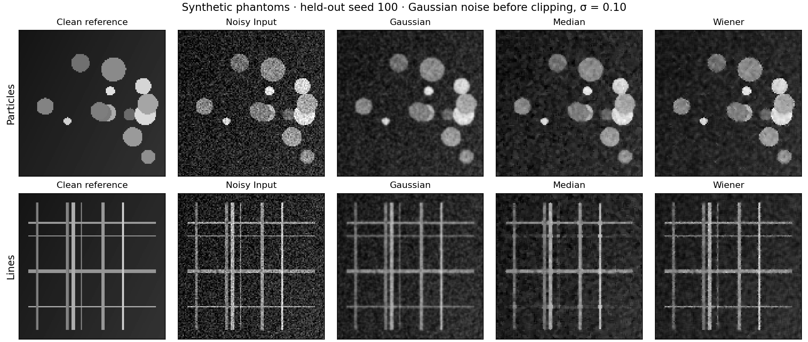

# Scientific Restoration Benchmark

A small, reproducible image-denoising benchmark that asks a practical question:
**does a better average image score preserve the structures that matter?**

It compares noisy input, Gaussian filtering, median filtering and a local Wiener filter.
Parameters are selected on calibration images and then frozen before evaluation on
different clean images. Every method receives the same noisy observations.

**Provenance:** Independent computational portfolio project by Ingyu Koh, created in
November 2026 with AI assistance. All inputs are synthetic particle and line phantoms.
The project is not client work, an instrument-acquisition record, or a microscopy research result.

## Run it

```bash
git clone https://github.com/ingyukoh/scientific-restoration-benchmark.git
cd scientific-restoration-benchmark
python3 -m venv .venv
source .venv/bin/activate
python -m pip install .
python -m unittest discover -s tests -v
python -m restoration_benchmark --verify-manifest reports/input_manifest.json
python scripts/verify_results.py
```

Python 3.11–3.12. The core library versions are pinned in `pyproject.toml`;
`requirements-lock.txt` also records the environment used for the committed run.
After dependency installation, the benchmark runs offline on a CPU. No GPU, model download,
API key, or instrument connection is required.

## Inspect the evidence

- [Generated result tables](reports/results.md)
- [Per-case measurements](reports/per_case.csv)
- [Selected settings and the complete calibration search](reports/selected_parameters.json)
- [Input manifest and hashes](reports/input_manifest.json)
- [Technical task and review rubric](TASK.md)
- [Method, interpretation and limitations](docs/METHOD.md)



## What the committed run shows

Gaussian filtering raises overall mean PSNR from **23.311 to 24.567 dB**, yet reduces
PSNR on the thin-line family from **23.319 to 22.309 dB**. Its line-pattern SSIM rises
at the same time. Different summaries can therefore suggest different conclusions.
The local Wiener baseline has the highest aggregate PSNR in this fixed experiment,
at **28.278 dB**. These are generated measurements on this synthetic split;
the [full report](reports/results.md) includes per-family scores and paired intervals.

## Protocol

| Item | Fixed choice |
|---|---|
| Images | 128×128 normalized grayscale particle and line phantoms |
| Calibration | 6 clean images, seeds 0–2 for each pattern family, two noise levels: 12 cases |
| Test | 16 different clean images, seeds 100–107 for each family, two noise levels: 32 cases |
| Corruption | Gaussian noise with requested σ=0.05 or 0.10, followed by clipping and 16-bit quantization |
| Selection | One setting per method, maximizing mean calibration PSNR across both noise levels |
| Scoring | Same five-pixel border excluded for every method |
| Metrics | PSNR, Gaussian-window SSIM, Sobel-gradient magnitude MAE |
| Uncertainty | 90% paired bootstrap interval for PSNR gain versus noisy input, grouped by clean image |

There is no neural-network training in this baseline. A more complex method has to
demonstrate a useful improvement over these inexpensive controls.

The local Wiener baseline estimates noise power as mean local variance. Image structure
contributes to that estimate, which can cause oversmoothing. This assumption is visible in
the code and is one candidate for investigation.

## What this demonstrates

Numerical computing, image processing, experiment design, calibration/test separation,
paired evaluation, uncertainty reporting, and a reproducible Python delivery.
The code is original to this repository. The mathematical methods and third-party
libraries are identified in [the method note](docs/METHOD.md).

The phantoms are deliberately limited. Real electron microscopy involves signal-dependent
noise, acquisition settings, drift and other effects that this generator does not model.
These results do not establish performance on an SEM dataset. Named instrument models and
claims about prior professional use are omitted because neither is part of this exercise.

## Layout

```text
src/restoration_benchmark/
  data.py         generated inputs, independent splits and hashes
  methods.py      noisy-input, Gaussian, median and local Wiener baselines
  metrics.py      documented full-reference metrics
  benchmark.py    calibration, evaluation, grouped intervals and report generation
tests/            metric checks, split guards, input integrity and feature-loss example
reports/          committed quality measurements and comparison panel
scripts/          numerical reproduction check against committed results
TASK.md           extension assignment and rubric
```

`reports/environment.json` and `reports/timing.json` are regenerated locally and ignored
by Git. Runtime values depend on the machine. The quality measurements and frozen settings
are checked in CI with numerical tolerance.

Code and generated synthetic data: [MIT license](LICENSE).
