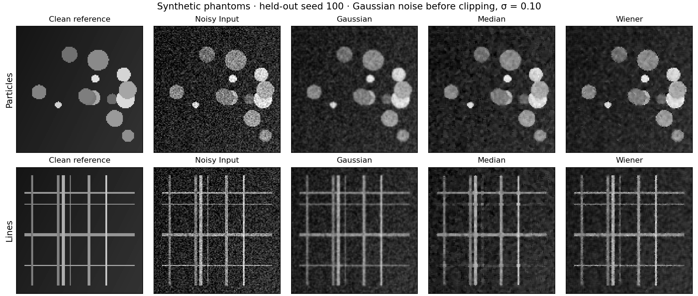

# Held-out denoising results

Generated by `python -m restoration_benchmark`. Synthetic images only.

12 calibration cases (6 clean images) select one setting per method. 32 test cases (16 different clean images, two noise levels) are scored afterwards.

| Method | Frozen setting | Mean PSNR (dB) ↑ | Mean SSIM ↑ | Edge MAE ↓ | 90% interval for ΔPSNR vs noisy input |
|---|---|---:|---:|---:|---|
| noisy_input | `{}` | 23.311 | 0.4950 | 0.03577 | [0.000, 0.000] dB |
| gaussian | `{"sigma": 0.7}` | 24.567 | 0.7023 | 0.03154 | [0.304, 2.184] dB |
| median | `{"size": 3}` | 24.442 | 0.6690 | 0.02742 | [-0.689, 2.893] dB |
| wiener | `{"size": 3}` | 28.278 | 0.7897 | 0.02061 | [3.969, 5.928] dB |

## By pattern family

| Family | Method | PSNR (dB) | SSIM | Edge MAE |
|---|---|---:|---:|---:|
| particles | noisy_input | 23.302 | 0.3570 | 0.03713 |
| particles | gaussian | 26.825 | 0.6580 | 0.02361 |
| particles | median | 28.779 | 0.6745 | 0.01923 |
| particles | wiener | 30.661 | 0.7476 | 0.01628 |
| lines | noisy_input | 23.319 | 0.6331 | 0.03441 |
| lines | gaussian | 22.309 | 0.7466 | 0.03947 |
| lines | median | 20.105 | 0.6635 | 0.03561 |
| lines | wiener | 25.895 | 0.8318 | 0.02493 |

## Interpretation and limits

A higher average PSNR does not establish preservation of small features. Inspect the line patterns, SSIM and edge error alongside the aggregate score.

Intervals resample the 16 clean-image groups, keeping their two noise levels together. They describe sampling variation within this generator, not performance on real microscopy.

Images are scored on [0,1] with the same five-pixel border excluded. SSIM uses an 11×11 Gaussian window (σ=1.5) and population covariance. Noise is added before clipping and 16-bit quantization. Its requested σ is not the variance of the clipped residual.

`timing.json` contains local measurements only: each entry is a median of three warm calls, excluding metrics and plotting. It is regenerated, not committed, and is not a cross-hardware speed claim.

